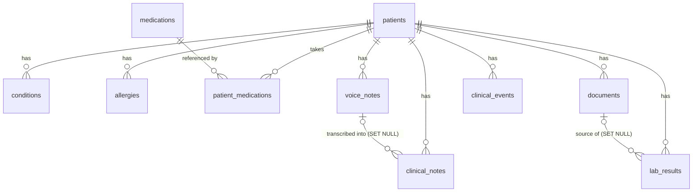

# Data Model — Clinical AI Copilot

Implemented in Task 2 (Alembic revision `d3d54628e9bd` — *create core clinical
entities*). PostgreSQL schema for the structured clinical data.

## Entities

| Table | Purpose | Key columns |
| --- | --- | --- |
| `patients` | Root entity — patient profile | name, `national_code` (unique, کد ملی), DOB, gender |
| `conditions` | Patient-scoped disease/condition | name, status (active/resolved), onset/resolved dates |
| `medications` | Shared medication catalog | name (unique), generic_name |
| `patient_medications` | Link: patient ↔ medication | dosage, frequency, status, start/end dates |
| `allergies` | Recorded allergy | allergen, reaction, severity |
| `documents` | Metadata for uploaded clinical files | doc_type, `storage_key` (unique, MinIO), mime, size, extraction_status, extracted_text |
| `voice_notes` | Clinical voice recordings | conversation_type, `audio_storage_key` (unique), duration, language, transcription_status, transcript |
| `clinical_notes` | Notes confirmed into the record | title, content, source (manual/voice/ai_assisted), `voice_note_id` (traceability) |
| `lab_results` | Selected important structured lab values | test_name, value (text), unit, reference_range, flag, `document_id` (source) |
| `clinical_events` | Patient timeline events | event_type (open set), event_date, title, source_type + source_id (polymorphic ref) |

All tables have `id` (integer PK), and timezone-aware `created_at`/`updated_at`
(`TimestampMixin`). All Persian clinical text is stored as UTF-8.

## Relationships

- All `patient_id` foreign keys use `ON DELETE CASCADE` — deleting a patient
  removes their clinical data; the DB enforces it even for bulk deletes.
- `clinical_notes.voice_note_id` and `lab_results.document_id` use
  `ON DELETE SET NULL` — deleting the original does not silently delete the
  derived/structured row, but the link is preserved while both exist
  (traceability).
- `patient_medications.medication_id` has no ON DELETE action — catalog
  medications cannot be deleted while referenced by any patient.
- `clinical_events.source_type`/`source_id` are a polymorphic reference
  (no DB-level FK) pointing back to the row an event was derived from.

## Indexes

- `ix_<table>_patient_id` on every child table (PostgreSQL does not index FKs).
- Composite `ix_lab_results_patient_date (patient_id, result_date)` and
  `ix_clinical_events_patient_date (patient_id, event_date)` for the two
  per-patient time-ordered queries (timeline, lab history).
- Unique: `patients.national_code`, `medications.name`,
  `documents.storage_key`, `voice_notes.audio_storage_key`.

## Design decisions

1. **Integer autoincrement PKs** (not UUIDs) — simplest choice for the MVP;
   the system has no external ID-exposure requirements yet. Can be revisited
   if public identifiers are ever needed.
2. **Conditions are patient-scoped rows**, not a catalog link (the spec lists
   `PatientMedication` explicitly but no `PatientCondition`) — conditions are
   entered as free clinical text with optional dates. Coded conditions
   (ICD-10) were deliberately deferred until a feature needs them.
3. **Medications ARE a catalog** (the spec names `PatientMedication` as a link
   entity) with minimal fields; richer drug data (RxNorm, interactions) waits
   for the prescription-safety subsystem.
4. **Original files live in object storage only** — `documents` and
  `voice_notes` store metadata plus the MinIO object key. `extracted_text` /
  `transcript` are derived data kept for search/AI context; they never
  replace the original.
5. **`lab_results.value` is text** — supports numeric («۱۷۶») and qualitative
  ("Positive") results alike. Numeric-only columns were avoided until a
  trending feature actually requires them.
6. **Native PostgreSQL enums** for status/type columns with explicit type
  names (`gender`, `document_type`, ...) — validated by the database, boring
  and readable. Adding values later requires a migration; that is acceptable.
7. **`clinical_events` uses an open string `event_type`** — the event set will
  grow feature by feature; a DB enum would require a migration for each new
  type.
8. **Deterministic constraint names** via the SQLAlchemy naming convention on
  `Base` — keeps Alembic autogenerate output stable.

## Migration

- File: `backend/alembic/versions/d3d54628e9bd_create_core_clinical_entities.py`
- Creates 10 tables, 10 enum types, all FKs/indexes/uniques.
- The downgrade was patched to drop the PostgreSQL enum types (autogenerated
  downgrades omit them), so the migration is **fully reversible**
  (`downgrade base` → `upgrade head` verified).
- `alembic check` reports no drift between models and the migrated database.

## Seed data

`backend/scripts/seed.py` inserts fictional sample data (3 patients with
conditions, medications, allergies, documents, voice notes — including one
doctor–patient conversation transcript — notes, lab results and 19 timeline
events). Development only; refuses to run when data exists unless `--reset`
is passed.
