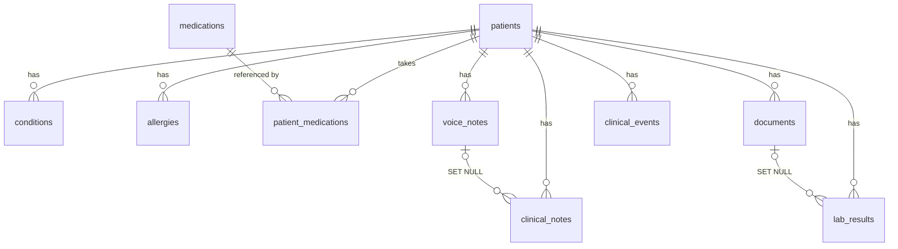

# گزارش تسک ۲ — مدل دادهٔ بیمار (Patient Data Model)

- **پروژه:** Clinical AI Copilot — دستیار هوشمند بالینی برای پزشکان
- **تسک:** تسک ۲ (Task 2) — طراحی و پیاده‌سازی مدل دادهٔ بیمار + مایگریشن Alembic + تست + دادهٔ نمونه (Seed)
- **تاریخ اجرا:** 2026-08-25
- **وضعیت:** ✅ تکمیل‌شده و راستی‌آزمایی‌شده
- **کامیت:** هنوز کامیت نشده است (فایل‌ها آمادهٔ کامیت هستند)

---

## ۱) دامنهٔ کار

فقط لایهٔ داده: مدل‌های ORM، یک مایگریشن Alembic، تست‌های دیتابیسی و اسکریپت Seed.
**هیچ قابلیت غیرمرتبطی اضافه نشد** — بدون endpoint جدید، بدون احراز هویت، بدون MinIO client، بدون RAG.

---

## ۲) موجودیت‌های نهایی دیتابیس (۱۰ جدول)

| جدول | نقش | ستون‌های کلیدی |
| --- | --- | --- |
| `patients` | ریشهٔ داده‌های بالینی | نام، `national_code` (یکتا، کد ملی)، تاریخ تولد، جنسیت |
| `conditions` | بیماری/مشکل بالینیِ هر بیمار | نام، وضعیت (active/resolved)، تاریخ شروع/رفع |
| `medications` | کاتالوگ دارو (مشترک) | نام (یکتا)، نام ژنریک |
| `patient_medications` | پیوند بیمار↔دارو | دوز، تناوب، وضعیت، تاریخ شروع/پایان |
| `allergies` | حساسیت ثبت‌شده | آلرژن، واکنش، شدت |
| `documents` | فرادادهٔ اسناد آپلودشده | نوع، `storage_key` (یکتا، MinIO)، mime، حجم، وضعیت استخراج، متن استخراج‌شده |
| `voice_notes` | ضبط صوتی بالینی | نوع گفتگو، `audio_storage_key` (یکتا)، مدت، زبان، وضعیت تبدیل به متن، رونوشت خام |
| `clinical_notes` | یادداشت تأییدشده در پرونده | عنوان، متن، منبع (manual/voice/ai_assisted)، `voice_note_id` |
| `lab_results` | مقادیر ساخت‌یافتهٔ منتخب آزمایش | نام آزمایش، مقدار (متنی)، واحد، بازهٔ مرجع، پرچم، `document_id` |
| `clinical_events` | رویدادهای تایم‌لاین بیمار | نوع (مجموعهٔ باز)، تاریخ، عنوان، ارجاع چندریختی source_type/source_id |

همهٔ جدول‌ها: `id` (PK عددی) + `created_at`/`updated_at` زمان‌دار (TimestampMixin). متن فارسی به‌صورت UTF-8.

## ۳) روابط مهم



- همهٔ `patient_id`ها: **ON DELETE CASCADE** (حذف بیمار = پاک‌شدن داده‌های بالینی‌اش، حتی در bulk delete).
- `clinical_notes.voice_note_id` و `lab_results.document_id`: **ON DELETE SET NULL** — حذف منبع، ردیف مشتق را حذف نمی‌کند ولی رد نشانه‌گیری حفظ می‌شود (Traceability).
- `patient_medications.medication_id`: بدون ON DELETE — ردیف کاتالوگِ ارجاع‌شده قابل حذف نیست.
- `clinical_events`: ارجاع چندریختی بدون FK سطح دیتابیس (مجموعهٔ نوع رویداد باز است).

ایندکس‌ها: `patient_id` روی همهٔ جدول‌های فرزند + ایندکس‌های مرکب `(patient_id, result_date)` و `(patient_id, event_date)` برای تایم‌لاین و تاریخچهٔ آزمایش‌ها + یکتایی روی `national_code` ، `medications.name` ، `storage_key`ها.

## ۴) مایگریشن

- **Revision:** `d3d54628e9bd` — *create core clinical entities*
- فایل: `backend/alembic/versions/d3d54628e9bd_create_core_clinical_entities.py`
- ۱۰ جدول + ۱۰ نوع enum بومی PostgreSQL + FKها/ایندکس‌ها/یکتایی‌ها با نام‌گذاری قطعی (naming convention)
- ⚠️ اصلاح دستی: نسخهٔ autogenerate در downgrade نوع‌های enum را drop نمی‌کرد → حلقهٔ `DROP TYPE` به downgrade اضافه شد؛ در نتیجه مایگریشن **کاملاً برگشت‌پذیر** است (آزمایش شد: upgrade → downgrade → upgrade ✔)
- `alembic check`: «No new upgrade operations detected» — عدم انحراف مدل‌ها از دیتابیس ✔

## ۵) تست‌ها و نتایج

`python -m pytest` → **۱۳ passed** (۱.۴ ثانیه):

| فایل | تست | نتیجه |
| --- | --- | --- |
| test_health.py | ۳ تست health/openapi | ✅ |
| test_models.py | ایجاد بیمار + مقادیر پیش‌فرض | ✅ |
| | یکتایی کد ملی (IntegrityError) | ✅ |
| | پیش‌فرض‌های Document/VoiceNote | ✅ |
| | پیوند Patient↔Medication کاتالوگی | ✅ |
| | یادداشت بالینی برخاسته از VoiceNote (SET NULL) | ✅ |
| | LabResult ← سند مبدأ (SET NULL) | ✅ |
| | Cascade حذف بیمار روی هر ۸ جدول فرزند + بقای کاتالوگ دارو | ✅ |
| test_seed.py | شمارش ردیف‌ها (۱۰ جدول) | ✅ |
| | کوئری‌پذیری و پیوندها (تایم‌لاین، یادداشت صوتی→یادداشت) | ✅ |
| | گارد اجرای مجدد + reseed با reset | ✅ |

نکتهٔ مهندسی: تست‌های دیتابیسی روی دیتابیس جداگانهٔ `clinical_ai_copilot_test` اجرا می‌شوند (ساخته‌شده خودکار) و هر تست در savepoint/rollback ایزوله است؛ اگر PostgreSQL در دسترس نباشد به‌صورت خودکار skip می‌شوند تا suite بدون زیرساخت هم سبز بماند.

## ۶) نتیجهٔ Seed

`python -m scripts.seed` (توسعه، دادهٔ فرضی، بدون فایل واقعی در MinIO):

```
patients 3 · conditions 5 · medications 4 · patient_medications 4 ·
allergies 2 · documents 3 · voice_notes 3 · clinical_notes 3 ·
lab_results 5 · clinical_events 19
```

- ۳ بیمار نمونه (علی رضایی، مریم احمدی، حسین کریمی) با محتوای بالینی فارسی واقع‌گرایانه
- سناریوهای پوشش‌داده‌شده: سند با استخراج کامل / در انتظار، یادداشت صوتی pending / completed، گفتگوی پزشک-بیمار با رونوشت، یادداشت بالینی منشأ‌گرفته از صوت، آزمایش normal/abnormal، وضعت resolved
- کوئری‌های اثباتی: join بیمار↔بیماری↔دارو ✔ و تایم‌لاین بیمار ۱ به‌ترتیب تاریخ نزولی ✔ (خروجی در گزارش چت)
- اجرای مجدد بدون `--reset` → خطا با خروج کد ۱ ✔

## ۷) فایل‌های تغییر‌یافته

**جدید:** `app/db/mixins.py`، `app/models/{enums,patient,condition,allergy,medication,document,voice_note,clinical_note,lab_result,clinical_event}.py`، `alembic/versions/d3d54628e9bd_*.py`، `scripts/{__init__,seed}.py`، `tests/{test_models,test_seed}.py`، `docs/data-model/README.md`، همین گزارش
**ویرایش:** `app/db/base.py` (naming convention)، `app/models/__init__.py`، `alembic/env.py` (import مدل‌ها)، `tests/conftest.py` (فیکسچرهای دیتابیس)، `README.md` ریشه، `backend/README.md`، `docs/README.md`
**حذف:** `alembic/versions/.gitkeep`

## ۸) تصمیم‌های مهندسی

1. **PK عددی افزایشی** (نه UUID) — ساده‌ترین گزینهٔ MVP؛ در صورت نیاز به شناسهٔ عمومی بعداً بازنگری می‌شود.
2. **شرایط بیمار به‌صورت ردیف متنی بیمارمحور** (نه پیوند به کاتالوگ) — طبق فهرست موجودیت‌های پروژه؛ کدگذاری ICD-10 عمداً به تعویق افتاد.
3. **داروها کاتالوگ‌اند** (چون `PatientMedication` صریحاً پیوند است) ولی حداقلی؛ دادهٔ غنی دارو (RxNorm/تداخل‌ها) منتظر زیرسیستم ایمنی نسخه.
4. **فایل‌های اصلی فقط در object storage** — جدول‌ها فراداده + کلید MinIO؛ `extracted_text`/`transcript` دادهٔ مشتق‌اند و هرگز جایگزین اصلی نمی‌شوند.
5. **`lab_results.value` متنی** — پشتیبانی هم‌زمان از مقادیر عددی و کیفی؛ ستون عددی جدا تا وقتی قابلیت روند (trending) واقعاً لازم شود اضافه نمی‌شود.
6. **Enum بومی PostgreSQL با نام صریح** برای وضعیت/نوع‌ها؛ `event_type` رشتهٔ آزاد چون مجموعه‌اش باز است.
7. **نام‌گذاری قطعی قیدها** روی `Base` — خروجی پایدار autogenerate.
8. **تست روی PostgreSQL واقعی** (نه SQLite) با دیتابیس جدا و skip خودکار — چون رفتار enum/CASCADE در SQLite متفاوت است.

## ۹) هشدارها/نکات باقی‌مانده

1. **پورت ۵۴۳۲ روی این ماشین اشغال است** (سرویس PostgreSQL دیگری از طریق localhost-forwarding بدون رد در netstat — احتمالاً داخل WSL). راه‌حل: در `.env` محلی `POSTGRES_PORT=5433` و `POSTGRES_HOST=127.0.0.1` شد. `.env.example` دست‌نخورده (۵۴۳۲) باقی مانده؛ روی ماشین‌های دیگر مشکلی نیست.
2. **حجم PostgreSQL قدیمی داکر** یک‌بار با اعتبارنامهٔ پیش‌فرض build شده بود → حذف و بازسازی شد (دیتابیس خالی بود؛ هیچ داده‌ای از دست نرفت).
3. هشدار اطلاعاتی Starlette دربارهٔ httpx/httpx2 همچنان هست (بدون اثر).
4. ردیف‌های seed به کلیدهای MinIO اشاره می‌کنند ولی فایلی آپلود نشده (خارج دامنهٔ این تسک — آپلود در تسک اسناد پیاده می‌شود).
5. Docker Desktop هنگام شروع روشن نبود و استارت زده شد؛ کانتینر postgres در پایان متوقف شد (volume و داده‌ها باقی‌اند: `docker compose up -d postgres`).

## ۱۰) گام بعدی

طبق دستورالعمل، پس از تسک ۲ **متوقف می‌شویم**. گام منطقی بعدی (پس از تأیید): endpointهای CRUD بیمار (API لایهٔ دادهٔ فعلی).
